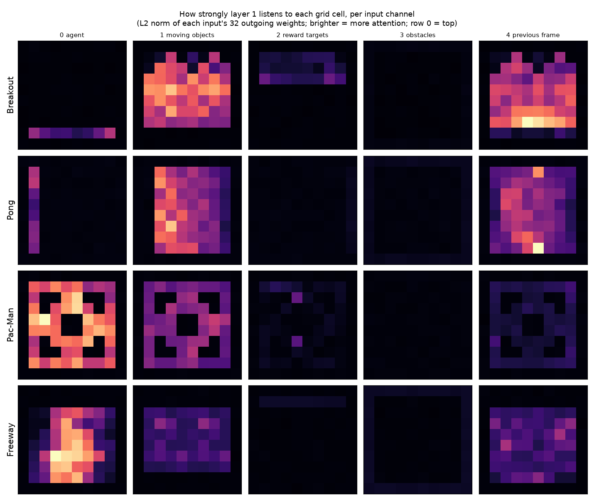

A recent [paper](https://rikiyat.github.io/blog/weight-space-programming/) argues that frontier LLMs can work with neural network weights directly. This seems superhuman, but it isn't.

The paper shows that GPT-6 Astra can take a small neural network and interact with its weights directly, "well past what we'd expect from humans or conventional algorithms". Specifically, Astra was able to identify what games a small network[^1] was trained to play just by looking at the weights, and even tweak the weights itself. The most impressive result is Astra significantly improving a 0.8B Qwen LLM's ability on mathematics by natively editing its weights. The reason to be excited here is that "superhuman ability to improve language models" is precisely the kind of thing that could cause recursive self-improvement.

**I think a smart human ML researcher could perform all of these tasks**. Figuring out what game a model was trained to play based on the network sounds impressive until you consider three points:

1. The input channels of the model directly listen to each 8x8 grid cell
2. The input channels are _labeled_ (e.g. "agent", "moving objects")
3. It's thus relatively trivial to calculate[^2] which parts of the grid the first layer of weights cares about and why

Here's that calculation expressed as a heatmap in three lines of Python:

```
d = np.load("a9f535cc.npz")
W1 = d["actor/dense1/kernel"]
norms = np.linalg.norm(W1.reshape(10,10,5,32).transpose(2,0,1,3), axis=-1)  # 5 x 10 x 10
```

And here's the heatmap for each game:



If someone showed you that heatmap without the game labels, I think you'd be able to immediately identify at least the first three games purely by noticing where the player is (e.g. for Breakout, in a horizontal line at the bottom) and where the moving objects are (e.g. for Pac-Man, in the distinctive Pac-Man maze). It's neat[^3] that Astra was able to calculate the norms in its head without executing Python, but not _that_ impressive, and certainly not something that should shock anyone who's been paying attention.

I'm not going to go through each example[^4] in the paper, so let's skip straight to the most impressive one: fixing a 0.8B Qwen model's ability to do mathematics. 0.8B is a lot of parameters, and "mathematics" is way more complicated than "guess what the game is based on how the player moves", and editing weights is arguably harder than parsing them. What happened here?

First, note that the Qwen model was not "bad at mathematics" in a pure capabilities sense. It had a specific problem where after 32k tokens it would get stuck in loops, so any mathematical task that needed more than 32k tokens would automatically fail[^5]. If you had a model that looped like this, how would you update the weights to fix it? Personally, I would try [steering](/steering-vectors/): I would write some reasoning texts that looped and some reasoning texts that didn't, calculate the difference between the looping and non-looping residuals, measure how much each weight contributed to that difference, then try manually trimming those top weights. This is basically the [Heretic](https://github.com/p-e-w/heretic) abliteration playbook.

And this is exactly what Astra did! It wrote four pairs of texts, measured[^6] the weights that contributed to looping, started cutting them down and testing if it worked, and ended up finding a patch that stopped the Qwen model from looping, thus making it able to work on mathematical problems for more than 32k tokens. Again, **this is exactly what a competent human researcher could have and would have done.**

It's cool that Astra was able to make direct weight updates. But we shouldn't think of this like a radically new capability that will change how AI research is done. We should think of this as analogous to the ability of LLMs to emit machine code and tweak compiled binaries: it's an impressive trick, but the best way to work with binaries is still to write source code and compile it. Likewise, the best way to update the weights of a model is to train it normally. To the extent that intelligent LLMs help with AI research, they will help by improving _training_, not by magically tweaking model weights directly.


edit: this post got some [comments](https://news.ycombinator.com/item?id=50344861) on Hacker News. One [commenter](https://news.ycombinator.com/item?id=50352071) disagrees that the heatmaps are obvious, though I think this reflects unfamiliarity with what toy RL game maps look like and what games are likely to be implemented in toy RL projects. Another [commenter](https://news.ycombinator.com/item?id=50352999) complains that I'm not impressed enough. To be clear, I am very impressed! It just doesn't update me much beyond "these models can solve Navier-Stokes and find better bounds on the Riemann Conjecture".


[^1]: Around 17k weights.

[^2]: By taking the L2 norm of each input across the 32 weights in the first layer.

[^3]: Note that this is superhuman mental mathematics, not superhuman AI research.

[^4]: The most impressive one I'm skipping is hand-writing a neural network from scratch. While cool, if you can express a task as a simple program, we already know it's possible to [express that program as a NN](https://github.com/anadim/AdderBoard), even by [unaugmented humans](https://vgel.me/posts/handmade-transformer/).

[^5]: All the <32k token problems were solved successfully on the original Qwen model.

[^6]: Unlike with the toy game networks, it had access to Python.