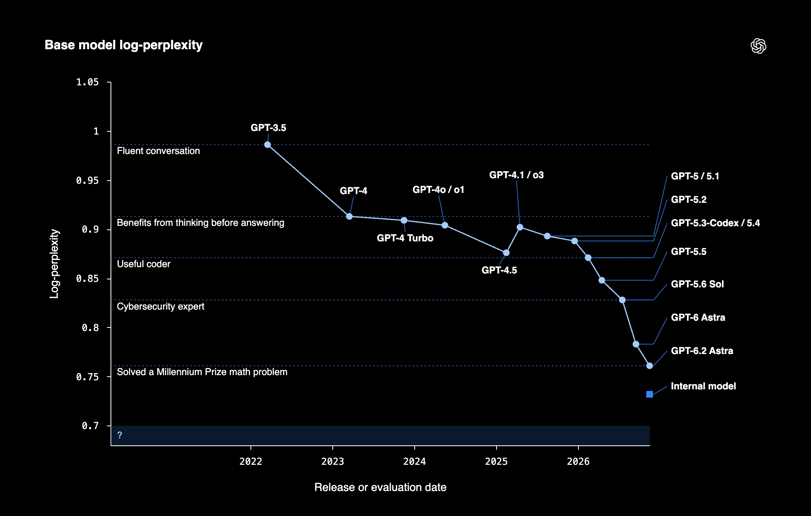
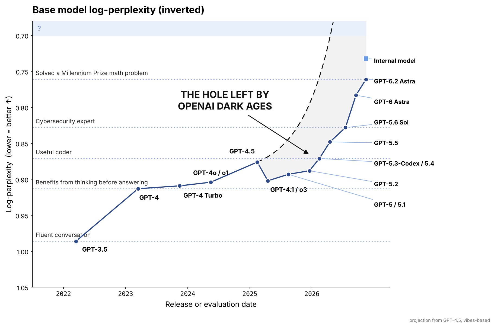

OpenAI have just [released](https://openai.com/index/perplexity-and-intelligence/) a fascinating graph showing the perplexity over time of all their released models:

Here are a bunch of thoughts I have about this:

### Why OpenAI?

- This is the most visibility we've ever had into the internal training metrics at a frontier lab
- Releasing training metrics in the name of safety is a very Anthropic move, and it's surprising OpenAI was the one to do it first
- Perplexity must be measured against some specific dataset (e.g. all models will score basically zero perplexity[^1] on the string "AAAAAAA....")
- We therefore shouldn't expect to be able to compare any similar data Anthropic releases with this data, except in terms of the angle on the graph[^2]

### Is perplexity a useful measure?

- Perplexity is an unsatisfying metric because it only predicts how well the model matches some held-out text: i.e. it only applies to pre-training
- For frontier models, the rumor is that pre-training is 50% or less of the total time and compute spent training a model; the rest is RL, which this perplexity data tells us nothing about the success of
- If you believe (as many do) that pre-training creates capabilities and RL merely elicits them, then perplexity _would_ actually be a useful metric for capabilities (and indeed it does seem to go down over time as models get better)
- However, even if post-training does not add new capabilities, there are clearly other measures of capability that do not necessarily correlate with perplexity, like the ability to improve with chain-of-thought

### What is surprising about the chart?

- Very few models share the same base (i.e. have the exact same perplexity). It was a common rumor that OpenAI was post-training 4o and 4.1 into many of their models, but it looks like it was just o1 and o3
- It's interesting that 4.1 and o3 share the same base, given how great a model o3 was and how underwhelming 4.1 was
- You can see the point where OpenAI briefly give up on making large pretrained models at GPT-4.5, which had similar perplexity to GPT-5.3-Codex but was _far_ less useful

It's unclear whether OpenAI chose not to pretrain further or hit some kind of internal scaling wall, but it's interesting to [consider the world](https://x.com/HououinTyouma/status/2124680498848973257?a=XfdQGewBJcJpXJDhSII&s=20) where they could keep smoothly scaling on top of GPT-4.5:

- You can see a real acceleration in perplexity loss from GPT-5.2 on
- This contradicts the common wisdom[^3] that OpenAI (and other labs) have largely given up on pretraining and are all-in on RL. Clearly the pretrained base models are improving rapidly as well

### What does this mean for alignment?

- AI safety researchers have been asking for more transparency into metrics like this for years
- However, I don't really know how much it helps. If the idea is to watch for a sudden scary drop in perplexity, only OpenAI will be in a position to notice, unless they start releasing data about the perplexity of their unreleased pretrained models (the graph shows one, but they should continue to do this)
- If the idea is for labs to agree on perplexity thresholds they won't cross (as the post suggests), it will be important to get more detail on what precisely the held-out dataset is

### Do the improvements in the graph match how strong the models feel?

- You can see a huge jump from GPT-3.5 to GPT-4 (which is how it felt), then broad stagnation[^4] until GPT-5.5, then rapid acceleration
- I personally did not feel a big jump with GPT-5.5: o3 and GPT-5.3-Codex were the "big jump" models for me
- However, that could be because those models were better RL-ed into using chain-of-thought tokens well, or avoiding the sycophancy trap, neither of which would show up in perplexity metrics.

I wrote this post up as dot points because I felt like I had a lot of loosely connected ideas about this news. If you found this much harder or much easier to read than my other posts, please email me[^5] about it and I will write either less or more posts in this format.

[^1]: Zero log-perplexity, technically, which is the measurement in OpenAI's graph. Perplexity approaches 1.

[^2]: It would be very interesting if Anthropic's data doesn't show the same broad pattern of pretrains getting smarter, but I bet it does.

[^3]: To the point where some people are [doubting](https://x.com/tobyordoxford/status/2124626330016678085?a=gTu7DSU8Q9X9RbrQoKo&s=20) the validity of the data.

[^4]: Except for GPT-4.5, which many people loved but did not feel particularly strong to me.

[^5]: You can reach me on Gmail at sean.goedecke.