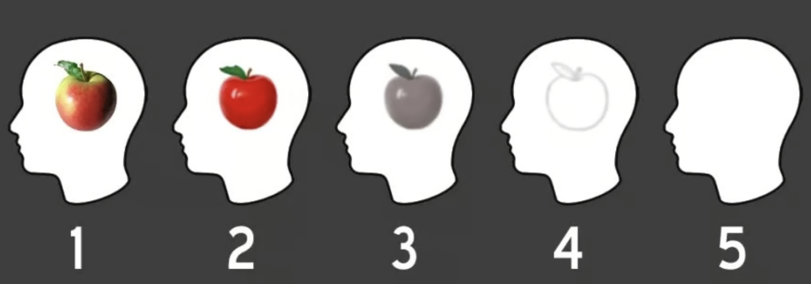

Close your eyes and imagine an apple. What did it look like, on the scale below? If you answer 5, congratulations! You have "aphantasia": the inability to visualize.

Here's where I start having difficulties. Taken literally, when I close my eyes and imagine an apple, I don't see anything, because my eyes are closed. But I can imagine what it would be like to see an apple. I can remember the last time I held an apple, what shape and color it was, and so on.

The harder I try, the more vivid detail I can remember. If I just vaguely think the word "apple", I don't have any picture in mind at all, but if I slowly ask myself questions - what color, what shape, does it have a stem or a sticker - I can fill in the missing details. Does being able to think about apples without picturing them make me a 5 on the scale? Does being able to picture an apple in full color make me a 1?

### Am I aphantasic?

I struggle to understand people who self-report as a 3 or higher. What do you mean, you can't imagine color or shade? If you're looking at a picture of an apple, you have an image of an apple in your mind; if you then close your eyes, do you immediately become unable to remember what the apple looked like?

Of course, it's always hard to imagine what's going on inside other people's heads. Just because their self-reported mental states baffle me doesn't mean they're not real. But this argument cuts both ways. If I have no real way of knowing what happens when you try and visualize an apple, aphantasics have no real way of knowing what happens when I try and do it. When they say they can't picture the apple, that's a _comparative_ claim: they're saying they lack some capacity which I possess. But how do they know what it's like for me? Couldn't they be imagining that I have some ultra-vivid inner experience that basically nobody has? Or do most people really have that kind of ultra-vivid inner experience, and am I just aphantasic?

### Dude, what if the red I see doesn't look the same as the red you see?

This is fundamentally a problem of language. Concepts are given meaning[^1] by _shared_ experience: for instance, the meaning of "pebble" is shared because I can pick up a pebble and pass it to you. Even quite complex concepts like "justice", "emergency", and "chair" operate like this: they depend upon a wide set of cases that we all basically agree are just or unjust, emergencies or routine cases, chairs or other objects. But "my inner experience of picturing an apple" is not like any of these. We only know about inner experience from our own version of it. I can describe mine to you and you can describe yours to me, but there is no shared experience that would let us actually communicate.

The standard stoner philosophy version of this question is "dude, what if the red I see doesn't look the same as the red you see?" This is an old question, but it gets at something legitimate: if your inner experience of "red" is the same as my inner experience of "green", _we would never know_. We would both call red things red and green things green. The only difference would be how it feels to experience each color, which cannot be communicated in language[^2]. 

Aphantasia seems like this to me. I believe _a priori_ that something like aphantasia exists: there is probably a spectrum of visual imagination, because every human capacity exists on a spectrum, therefore there are probably some people who have basically zero ability to picture things. However, I think it is near-impossible in practice for people to accurately figure out where they are on the spectrum, because you can only compare your ability to imagine by talking about it, and language just inherently cannot communicate inner experiences.

### Okay, what about the studies?

There is exactly one guy who is in a position to know whether aphantasia is real. We don't know his name, but the [paper](https://pubmed.ncbi.nlm.nih.gov/19733188/) about him calls him "MX". After heart surgery, MX started claiming to have lost the ability to visualize things, and convinced a British professor of neurology to fMRI him and write up a paper about it. Since then there have been 

[^1]: Since we are now doing philosophy, I need to supply the caveat that there are many competing theories about how concepts work, of which this is merely one. However (in my view) they all depend on shared experience in some form or other.

[^2]: Per [Wittgenstein](https://web.stanford.edu/~paulsko/Wittgenstein293.html): Suppose everyone had a box with something in it: we call it a "beetle". No one can look into anyone else's box, and everyone says he knows what a beetle is only by looking at his beetle. Here it would be quite possible for everyone to have something different in his box. One might even imagine such a thing constantly changing. But suppose the word "beetle" had a use in these people's language? If so it would not be used as the name of a thing. The thing in the box has no place in the language-game at all; not even as a something: for the box might even be empty.